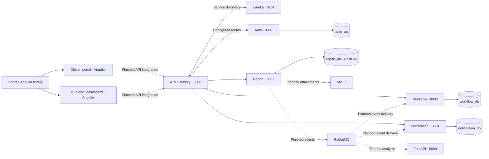

# CivicSignal

CivicSignal is an academic engineering project for reporting urban issues and coordinating municipal interventions in Casablanca. The citizen portal is designed to collect descriptions, photos and locations. The municipal dashboard is designed to help staff review reports, assign interventions and track resolution. The project also plans to evaluate AI-assisted classification, severity prediction and duplicate detection.

The current foundation includes French-language Angular prototypes, Java service discovery, local infrastructure and an AI health endpoint. The interfaces use demonstration data. The MVP is in development. See [development progress](docs/PROGRESS.md).

## Architecture



Solid lines show configured dependencies. The Gateway and all four Java business services register with Eureka. FastAPI runs separately. Dashed lines show planned integration work.

## Repository

```text
backend/
  eureka-server/          Service registry
  api-gateway/            REST routing under /api
  auth-service/           Accounts and roles
  report-service/         Report content, attachments and geospatial data
  workflow-service/       Status, priority, assignment and AI analysis ownership
  notification-service/   Notification delivery and preferences
frontend/
  projects/portal/        Citizen web application
  projects/dashboard/     Municipal web application
  projects/shared/        Report types, demonstration fixtures and shared theme
ai-service/
  app/ training/ datasets/ models/ tests/
infrastructure/
  postgres/               Database bootstrap script
  minio/                  Pinned MinIO source build
docs/                     Original project specifications
```

Root files include `AGENTS.md` for development conventions, `.env.example` for local configuration, `.gitignore` and `docker-compose.yml`.

## Technology

| Area | Version |
| --- | --- |
| Backend | Java 21, Maven Wrapper 3.3.4 and Maven 3.10.1, Spring Boot 4.1.2, Spring Cloud 2025.1.2, springdoc 3.2.1 |
| Frontend | Angular and CLI 22.3.0, Angular Material and CDK 22.2.0, TypeScript 6.0.3, Leaflet 1.9.4 |
| Local tooling | Node.js 26.13.1, npm 11.20.0, Python 3.12.10, Git 2.56.0 |
| AI service | FastAPI 0.165.0, Uvicorn 0.54.0 |
| Infrastructure | PostgreSQL 17.12 and PostGIS 3.7.0, RabbitMQ 4.2.9 Management, MinIO RELEASE.2025-10-15T17-29-55Z |

## Prerequisites

- Git, Java 21 and Node.js 26 with npm 11. Each Java project includes a Maven wrapper.
- Python 3.12 for FastAPI.
- Docker with Compose and a running Linux engine. Verification used Docker Desktop with WSL2.
- Internet access for the initial dependency downloads, Docker pulls and MinIO source build.

Clone the repository before running the setup commands.

```powershell
git clone https://github.com/marouaneouazry/CivicSignal.git
Set-Location CivicSignal
```

## Run the demo interfaces

From the repository root in PowerShell:

```powershell
Set-Location frontend
npm ci
npm run build
npm run portal
# In another terminal, from frontend
npm run dashboard
```

Open the citizen portal at [localhost:4200](http://localhost:4200) and the municipal dashboard at [localhost:4201](http://localhost:4201). The interfaces run without Docker or Java. OpenStreetMap tiles require network access. The landing image is a generated illustration.

### Supervisor walkthrough

1. Open the portal and inspect the issue categories and reporting steps.
2. Open a category and add a sample photo, description and location. The form previews the image locally and validates the inputs.
3. Visit the account forms and sample tracking page.
4. Open the dashboard to view the sample KPIs and charts. Filter reports by quartier, category, severity or status, then open a report's analysis preview.

Casablanca reports, statistics and analysis labels are examples. Account and reporting forms display local demo feedback. Persistence, identity and model inference are pending.

## Run the infrastructure

Start Docker Desktop. On a fresh checkout, copy [the environment template](.env.example) to `.env` and replace its placeholder passwords with distinct local values. Preserve any existing `.env`. Compose and the database-backed Java apps read this file.

```powershell
if (-not (Test-Path .env)) { Copy-Item .env.example .env }
# Set local credentials in .env before continuing.
docker compose config --quiet
docker compose pull postgres rabbitmq
docker compose up -d --build --wait
docker compose ps
```

Compose builds the MinIO Community Edition image locally from the pinned [upstream source release](https://github.com/minio/minio/releases/tag/RELEASE.2025-10-15T17-29-55Z), using `infrastructure/minio/Dockerfile`. The first build needs internet access to fetch the Go and Alpine base images, MinIO source and Go dependencies. Later starts can reuse the local image.

PostgreSQL is available on port 5432, RabbitMQ on 5672 and its management UI on 15672. MinIO uses 9000 for the API and 9001 for the console. Published services bind to localhost. The PostgreSQL script provisions `auth_db`, `report_db`, `workflow_db` and `notification_db`, each with its own owner. It runs on first initialization of the PostgreSQL volume. PostGIS is enabled in `report_db`.

## Run Java services

From each service directory, run `.\mvnw.cmd spring-boot:run` in a separate terminal. On macOS or Linux use `sh ./mvnw spring-boot:run`. Start Eureka first, then the Gateway and the four database-backed services. The four services load the root `.env` when started from their project directories.

| Directory under backend | Port | Local check |
| --- | ---: | --- |
| eureka-server | 8761 | `/` |
| api-gateway | 8080 | `/actuator/health` |
| auth-service | 8081 | `/swagger-ui.html` |
| report-service | 8082 | `/swagger-ui.html` |
| workflow-service | 8083 | `/swagger-ui.html` |
| notification-service | 8084 | `/swagger-ui.html` |

The Gateway reserves the v2.1 API paths for their owning services and strips `/api` when forwarding. The four OpenAPI definitions initially have no business operations. Run `.\mvnw.cmd test` from each project to compile and execute its test phase.

## Run FastAPI

```powershell
Set-Location ai-service
python -m venv .venv
.\.venv\Scripts\python.exe -m pip install -r requirements.txt
.\.venv\Scripts\python.exe -m uvicorn app.main:app --port 8000
```

Check [GET /ai/health](http://localhost:8000/ai/health) or open [FastAPI docs](http://localhost:8000/docs). The AI README describes the planned ResNet50 and EfficientNet evaluation, severity prediction and multimodal duplicate detection.

## Local addresses

| Component | Address |
| --- | --- |
| Citizen portal | [localhost:4200](http://localhost:4200) |
| Municipal dashboard | [localhost:4201](http://localhost:4201) |
| Eureka registry | [localhost:8761](http://localhost:8761) |
| API Gateway health | [localhost:8080/actuator/health](http://localhost:8080/actuator/health) |
| PostgreSQL | `localhost:5432` |
| RabbitMQ | `localhost:5672`, [management UI](http://localhost:15672) |
| MinIO | `localhost:9000`, [console](http://localhost:9001) |
| FastAPI | [localhost:8000/docs](http://localhost:8000/docs) |

## Project documentation

- [UML and architecture v2.1](docs/CivicSignal_Conception_UML_Architecture_PFA_EMSI.pdf) governs the architecture, service contracts and Angular workspace.
- [Cahier des charges v2.0](docs/CivicSignal_Cahier_des_charges_PFA_EMSI%20%281%29.pdf) provides functional background.
- [Progress and roadmap](docs/PROGRESS.md)
- [Contribution guide](CONTRIBUTING.md) and [agent instructions](AGENTS.md)
- [Angular workspace](frontend/README.md) and [AI service](ai-service/README.md)

## Verification

- Angular production builds and the shared status presentation test passed. Edge smoke checks covered all eight pages, photo preview, location selection with tiles unavailable, report filtering and 375 px layouts.
- Maven's test phase compiled all six Java projects with Java 21. The skeletons have no Java test cases yet.
- FastAPI returned HTTP 200 for `/ai/health`. Its HTTP smoke test passed on port 18087.
- Compose started all three infrastructure containers and reported them healthy on Docker Desktop with WSL2. All four dedicated PostgreSQL owners authenticated over TCP and were denied access to each other's databases. PostGIS was confirmed in `report_db`. The RabbitMQ management UI and authenticated API, the MinIO console and a signed S3 bucket listing responded successfully.

## Remaining development

- Add migrations, identity and role enforcement, report storage and MinIO attachments.
- Implement workflow transitions, validation, assignment and status updates.
- Define and integrate RabbitMQ event publication, retry handling, notifications, SSE and email.
- Curate datasets, train and evaluate PyTorch models, and integrate predictions with human review.
- Connect the Angular apps to the APIs and add integration tests and deployment packaging.
